# Brightloop Software – Subscription Management System
## Entity-Relationship Diagram (ERD) & Schema Documentation

```mermaid
erDiagram
    USERS ||--o{ USER_ROLES : has
    ROLES ||--o{ USER_ROLES : assigned_to
    USERS ||--o| CUSTOMER_PROFILES : has
    USERS ||--o| STAFF_PROFILES : has
    USERS ||--o{ PASSWORD_RESET_TOKENS : owns
    USERS ||--o{ AUDIT_LOGS : performs

    USERS ||--o{ QUOTATIONS : creates_or_receives
    SUBSCRIPTION_PLANS ||--o{ QUOTATIONS : configures
    QUOTATIONS ||--o{ QUOTATION_LINES : contains
    PRODUCTS ||--o{ QUOTATION_LINES : item
    PRODUCT_VARIANTS ||--o{ QUOTATION_LINES : variant

    USERS ||--o{ SUBSCRIPTIONS : belongs_to
    SUBSCRIPTION_PLANS ||--o{ SUBSCRIPTIONS : follows
    SUBSCRIPTIONS ||--o{ SUBSCRIPTION_LINES : items
    PRODUCTS ||--o{ SUBSCRIPTION_LINES : product
    PRODUCT_VARIANTS ||--o{ SUBSCRIPTION_LINES : variant
    SUBSCRIPTIONS ||--o{ SUBSCRIPTION_HISTORY : audit_trail
    SUBSCRIPTIONS ||--o{ SUBSCRIPTION_DISCOUNTS : applies
    DISCOUNTS ||--o{ SUBSCRIPTION_DISCOUNTS : applied_in

    PRODUCTS ||--o{ PRODUCT_VARIANTS : has_variants
    PRODUCTS ||--o{ PRODUCT_TAXES : subject_to
    TAXES ||--o{ PRODUCT_TAXES : specifies

    SUBSCRIPTIONS ||--o{ INVOICES : generates
    USERS ||--o{ INVOICES : billed_to
    INVOICES ||--o{ INVOICE_LINES : contains
    SUBSCRIPTIONS ||--o{ BILLING_RECORDS : prevents_duplicates
    INVOICES ||--|| BILLING_RECORDS : created_by

    DISCOUNTS ||--o{ DISCOUNT_PRODUCTS : restricts_to
    DISCOUNTS ||--o{ DISCOUNT_PLANS : restricts_to
    DISCOUNTS ||--o{ DISCOUNT_USAGE : tracks
    INVOICES ||--o{ DISCOUNT_USAGE : applies_on

    INVOICES ||--o{ PAYMENTS : settles
    USERS ||--o{ PAYMENTS : pays
```

### Key Business Constraints
1. **Duplicate Billing Prevention**: `billing_records` maintains a unique constraint `UNIQUE (subscription_id, billing_period_start)`. Any duplicate execution of the recurring billing engine safely aborts with no double-charging.
2. **Payment Tracking & Balance Reconciliation**: Invoices track `total_amount`, `paid_amount`, and `balance_due`. Each payment automatically decreases `balance_due` and transitions the invoice from `CONFIRMED` to `PARTIALLY_PAID` or `PAID`.
3. **Product Variants**: Each variant defines an `additional_price` added to the base product `sales_price` (e.g. ₹1000 base + ₹560 Enterprise variant = ₹1560 total unit price).
4. **Subscription Lifecycle**: `DRAFT -> QUOTATION -> CONFIRMED -> ACTIVE -> CLOSED` (plus `PAUSED`, `CANCELLED`). Transitions are auditable in `subscription_history`.

